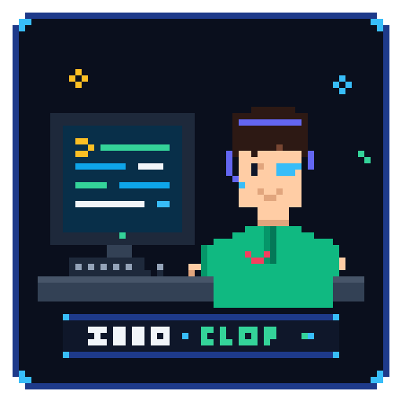

<p align="center">
  
</p>

<h1 align="center">🛡️ Zero AI-Slop Engineer</h1>

<p align="center">
  <strong>Universal Multi-Disciplinary Software Engineering Constitution & Autonomous Anti-Slop Agent Skill</strong>
</p>

<p align="center">
  <a href="https://github.com/MADHacker912/zero-ai-slop-engineer/stargazers"></a>
  <a href="https://github.com/MADHacker912/zero-ai-slop-engineer/blob/main/LICENSE"></a>
  <a href="#"></a>
  <a href="#"></a>
</p>

---

## 💡 Why This Exists

Most AI coding agents generate **"AI-Slop"**:
- ❌ Generic, repetitive purple-indigo gradient backgrounds (`#667eea`, `#764ba2`)
- ❌ Pointless glassmorphism, floating blur blobs, and card-inside-card syndrome
- ❌ Fake placeholder buttons (`onClick={() => {}}`) and empty mocks disguised as completed features
- ❌ Backend connection secrets leaked directly into client-side bundles
- ❌ Swallowed errors (`catch (e) {}`), silent failures, and zero test verification
- ❌ Claiming tasks are complete without running a single build, test, or visual inspection

**Zero AI-Slop Engineer** transforms the AI agent from a lazy code generator into an elite, disciplined **Multi-Disciplinary Senior Engineering Team** that writes intentional, production-ready, beautiful software.

---

## 🏛️ Multidisciplinary Senior Roles

When active, the agent acts as a unified engineering powerhouse:
1. **Senior Software Architect** — Modular boundaries, clean architecture, SOLID principles, zero speculative dead abstractions.
2. **Senior Frontend Engineer** — Strict TypeScript typing (zero `any`), performant DOM/CSS rendering, hydration safety.
3. **Senior Backend Engineer** — Resilient APIs, validation, transactions, structured error envelopes, semantic HTTP codes.
4. **UI/UX & Product Designer** — Distinctive visual art direction, typography hierarchy, design tokens, zero generic templates.
5. **Database Engineer** — Schema integrity, foreign keys, indexes, migrations, ACID transactions, Row-Level Security.
6. **Security Engineer** — OWASP Top 10, threat modeling, CSRF/XSS/SSRF prevention, secret management.
7. **QA Engineer** — Playwright E2E suites, Vitest unit tests, visual regression, real execution evidence.
8. **DevOps Engineer** — Docker, CI/CD, Nginx, health checks, rollback plans.
9. **Performance Engineer** — Core Web Vitals, profiling, bundle splitting, memory leak prevention.
10. **Accessibility Specialist** — WCAG 2.1 AA compliance, ARIA semantics, keyboard navigation.

---

## ⚡ The Core Universal Directives

### 1. Ponytail Discipline (Full Intensity)
> **Shortest working diff wins. Boring over clever. Fix root causes, not symptoms.**
- **YAGNI**: If speculative, skip it and say so.
- **Reuse Existing Code**: Check codebase helpers, types, and tokens before inventing new ones.
- **Stdlib & Native Platform First**: Use native HTML/CSS/DB constraints before adding packages.
- **Minimum Code That Works**: One line where possible; output code/action first.

### 2. Strict Backend & Frontend Separation
- Zero backend calls, admin keys, persistence engines, or DB connections in client-side code.
- Clear API boundaries (`fetch('/api/...')`).

### 3. Approved Component Ecosystem & Luxury Palettes
- **Approved UI Ecosystem**: Aceternity UI, Magic UI, shadcn/ui, 21st.dev, Uiverse.io, Spline.
- **Approved Illustrations**: 3Dicons, Open Peeps, unDraw (zero generic AI clipart).
- **Luxury Color Palettes**:
  - *Royal Dark Navy*: `#001F3F`, `#0A192F`, `#020C1B`
  - *Warm Editorial Neutral*: `#B38B6D`, `#333333`, `#696969`, `#222222`
  - *Clean Tech Frost*: `#F8F8FF`, `#E6E6FA`, `#B0C4DE`, `#2F4F4F`

---

## 🔄 11-Phase Project Execution Workflow

```
Discovery ➔ Research ➔ Architecture ➔ Design ➔ Implementation ➔
Integration ➔ Testing ➔ Visual Audit ➔ Security Audit ➔ Deployment ➔ Documentation
```

1. **Discovery** — Clarify requirements, user personas, business goals, and constraints.
2. **Research** — Inspect existing codebase conventions and documentation.
3. **Architecture** — Define boundaries, schemas, and clean folder structures.
4. **Design** — Establish visual rules, typography scales, and tokenized colors.
5. **Implementation** — Write clean, minimal, functional code with Ponytail discipline.
6. **Integration** — Wire frontend, backend, database, and auth securely.
7. **Testing** — Run automated tests and verify real terminal output.
8. **Visual Audit** — Inspect rendered screens across mobile, tablet, and desktop viewports.
9. **Security Audit** — Check OWASP Top 10, sanitization, and secret isolation.
10. **Deployment** — Build production bundles and verify container health.
11. **Documentation** — Deliver accurate README, runbooks, and setup guides.

---

## 🔍 Automated Anti-Slop Audit Scanner

Includes a built-in Python scanner (`scripts/audit_anti_slop.py`) to inspect any codebase for AI slop patterns:

```bash
# Scan current repository
python scripts/audit_anti_slop.py .

# Output example:
# ═══════════════════════════════════════════════════════════════
#    🛡️  ZERO AI-SLOP CODEBASE AUDITOR & QUALITY SCANNER
# ═══════════════════════════════════════════════════════════════
# Scanned 142 files.
# ✅ 100% CLEAN! Zero AI-slop patterns or placeholder defects found.
```

---

## 🚀 Installation & Agent Setup

### For Antigravity / Gemini CLI / Claude Code
Clone or link the skill into your skills directory:

```bash
# Clone the repository
git clone https://github.com/MADHacker912/zero-ai-slop-engineer.git ~/.gemini/config/skills/zero-ai-slop-engineer

# Or symlink to agent directory
ln -s ~/.gemini/config/skills/zero-ai-slop-engineer ~/.agents/skills/zero-ai-slop-engineer
```

The agent will automatically discover `SKILL.md` and adhere to the Zero AI-Slop Constitution across all software engineering workflows!

---

## 📜 Quality Gate Scorecard

Before any task is marked done, verify all 11 criteria in [checklists/quality_gate.md](checklists/quality_gate.md):
- [x] UI/UX: Custom aesthetic, no generic templates, no repetitive gradients
- [x] Frontend: Strictly typed, no `any`, performant composition, no leaks
- [x] Backend: Real endpoints, input validation, semantic HTTP codes
- [x] Architecture: Ponytail discipline followed, minimal working diff
- [x] Database: ACID consistency, indexes, foreign keys, migrations
- [x] Security: Zero secrets in client, OWASP Top 10 guarded
- [x] Performance: Zero CLS, optimized assets, no N+1 queries
- [x] Accessibility: Semantic HTML, WCAG AA contrast, keyboard navigation
- [x] Testing: Automated tests executed with verified output
- [x] Responsiveness: Verified on mobile, tablet, and desktop viewports
- [x] Error Handling: Loading, error, and empty states handled gracefully

---

## 👤 Author & Credits

Created by **[Saksham Gupta (MADHacker912)](https://github.com/MADHacker912)**  
Licensed under the **MIT License**.
